<div align="center">
  
  <h1>Codex Sentinel</h1>
  <p><strong>A desktop home for Codex quota, scheduled work, and interrupted conversations.</strong></p>
  <p>See your next window. Plan the next turn. Pick up where you left off.</p>
  <p>
    <a href="https://github.com/iss-hui/codex-sentinel/releases/latest"></a>
    <a href="https://github.com/iss-hui/codex-sentinel/actions/workflows/release.yml"></a>
    <a href="pyproject.toml"></a>
    <a href="LICENSE"></a>
  </p>
  <p><strong>English</strong> · <a href="README_zh.md">简体中文</a></p>
  <p><a href="https://github.com/iss-hui/codex-sentinel/releases/latest">Download</a> · <a href="#quick-start">Quick start</a> · <a href="#product-tour">Product tour</a> · <a href="#how-it-works">How it works</a> · <a href="#development">Development</a></p>
</div>

<picture>
  <source media="(prefers-color-scheme: dark)" srcset="docs/assets/readme/en/overview-dark.png">
  <source media="(prefers-color-scheme: light)" srcset="docs/assets/readme/en/overview-light.png">
  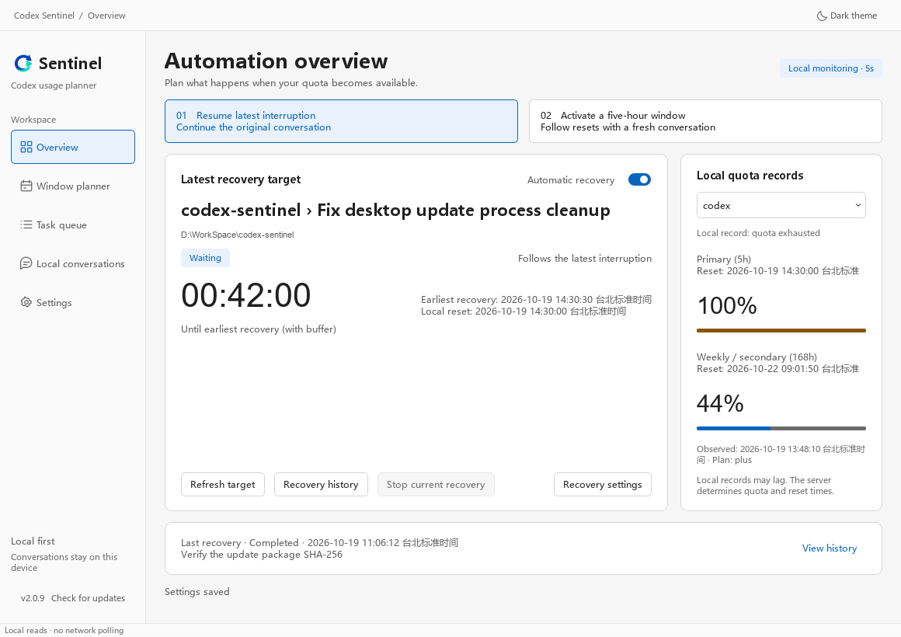
</picture>

*Actual PySide6 desktop UI, captured with synthetic local data. Screenshots throughout this guide include dark and light variants and follow your GitHub theme. [Screenshot sources and reproduction](docs/assets/readme/README.md).*

Codex Sentinel brings locally recorded quota, conversation recovery, and scheduled CLI turns into one native desktop application. It is built for developers who want to keep track of long-running Codex work, prepare a turn before their next work session, and inspect what happened afterward.

The interface has five focused pages, a system tray, English and Chinese translations, and persistent dark, light, and system appearance settings. Execution uses your installed official Codex CLI and existing sign-in.

> Quota resets are controlled by the server. Sentinel reads local observations and can schedule a turn after a recorded reset; it cannot reset quota, bypass a limit, or guarantee that a message starts a new five-hour window.

## Highlights

| Capability | What you get |
| --- | --- |
| **Local quota overview** | Five-hour and weekly usage, recorded reset times, observation age, and quota groups. Missing or stale values stay explicit. |
| **Conversation recovery** | Opt in to resume the latest quota-interrupted user conversation after the known reset and buffer. Dedicated history keeps results and logs together. |
| **Continuous activation** | Send a lightweight turn in a fresh read-only conversation at each newly recorded window, with a choice of directory, model, and optional first activation time. |
| **Window planner** | Schedule a message or task by date, the next recorded reset, or a lead time before your planned work start. |
| **Execution queue** | Edit, reorder, reschedule, pause, stop, and inspect persisted tasks with per-task permissions and raw CLI logs. |
| **Native desktop workflow** | Search local conversations, switch themes instantly, keep monitoring in the tray, and update supported Windows builds from the app. |

## Quick start

### Download a release

Get the latest package from **[GitHub Releases](https://github.com/iss-hui/codex-sentinel/releases/latest)**. Every release also includes `SHA256SUMS.txt` for verifying downloaded assets.

| Platform | Asset | Start |
| --- | --- | --- |
| **Windows x64 — folder build** | `CodexSentinel-windows-x64-v<version>.zip` | Extract the entire archive and open `CodexSentinel.exe`. Keep `_internal` beside it. |
| **Windows x64 — single file** | `codex-sentinel-windows-x64-v<version>.exe` | Run the downloaded executable. |
| **Linux x64** | `codex-sentinel-linux-x64-v<version>` | Make the binary executable, then run it in a graphical session. |
| **macOS** | `codex-sentinel-macos-v<version>` | Use the binary provided by the release, or run from source. |
| **Python** | Versioned `.whl` and `.tar.gz` | Install the package or follow the source instructions below. |

Install and sign in to the official Codex CLI first. Sentinel detects it locally; you can also select its executable in **Settings**. Packaged builds do not require a separate Python installation; running from source requires Python 3.10 or newer.

### Your first session

1. Open **Settings**, confirm the Codex CLI and local data directories, and choose your language and theme.
2. Check **Overview** for local quota observations and their recorded reset times. An unknown value means no usable local record was found.
3. Enable **conversation recovery** to continue a quota-interrupted chat, or choose **continuous activation** for lightweight turns in fresh chats. Both are opt-in and mutually exclusive.
4. Use **Window planner** for manual schedules, then follow their progress and logs in **Execution queue**. Review the desktop takeover setting before enabling execution: it is on by default and can interrupt work currently running in Codex Desktop.

### Run from source

On Windows, using PowerShell:

```powershell
git clone https://github.com/iss-hui/codex-sentinel.git
cd codex-sentinel
python -m venv .venv
.\.venv\Scripts\python.exe -m pip install -e .
.\.venv\Scripts\python.exe run_desktop.py
```

<details>
<summary>Linux / macOS source setup</summary>

```sh
git clone https://github.com/iss-hui/codex-sentinel.git
cd codex-sentinel
python3 -m venv .venv
.venv/bin/python -m pip install -e .
.venv/bin/python run_desktop.py
```

</details>

Installed entry points:

```sh
codex-sentinel                     # Desktop application
codex-sentinel-gui                 # Windowed entry point
codex-sentinel --gui --lang en     # English interface
codex-sentinel --gui --dry-run     # Simulate execution without sending turns
codex-sentinel --daemon            # Legacy headless daemon
codex-sentinel --status            # Legacy one-time quota check
```

`--buffer 30`, `--buffer 60`, and `--prompt` override the corresponding desktop settings. GUI startup errors are reported rather than falling back to a message-sending daemon. `--no-relaunch` applies only to the legacy daemon; desktop takeover and reopening are configured in Settings.

## Product tour

### Overview · choose the next action

The overview above pairs the recovery or activation workspace with local quota records. The selected conversation, complete working directory, next eligible time, and buffered countdown stay visible together. Narrow windows stack these panels; tables retain their columns with internal scrolling.

| Workflow | Target and trigger | Execution policy |
| --- | --- | --- |
| **Automatic recovery** | Latest eligible quota interruption, selected by interruption time; waits for known exhausted windows and the buffer. | Workspace write with Codex automatic approval reviews (`codex exec --approve-for-me`). |
| **Continuous activation** | A fresh chat at each newly recorded five-hour reset; optional first activation date and time. Weekly limits still apply. | Read-only lightweight turn; MCP servers, connectors, and plugins are disabled for this invocation only. |
| **Manual schedules** | A new or existing chat at a time selected in the planner. | Read-only by default; permission policy is chosen for each task. |

Recovery and activation run independently of the manual queue switch, but share one executor with scheduled tasks. Due recovery takes priority after the current task finishes. Recovery enable/disable saves immediately; turning it off also stops an active recovery. Prompt and buffer edits require saving.

<details>
<summary>View continuous activation and recovery settings</summary>

<picture>
  <source media="(prefers-color-scheme: dark)" srcset="docs/assets/readme/en/activation-dark.png">
  <source media="(prefers-color-scheme: light)" srcset="docs/assets/readme/en/activation-light.png">
  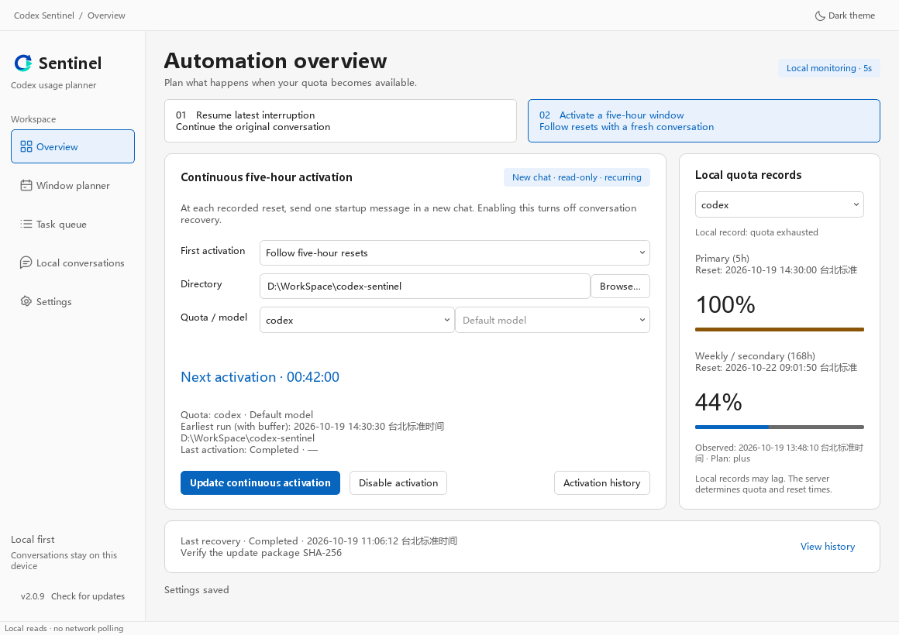
</picture>

Choose the quota group, working directory, and model. Each recorded window is attempted once, and durable state prevents replay after restart, failure, or cancellation. After sending, Sentinel waits for a new local reset observation; it does not assume another reset five hours later.

<picture>
  <source media="(prefers-color-scheme: dark)" srcset="docs/assets/readme/en/recovery-settings-dark.png">
  <source media="(prefers-color-scheme: light)" srcset="docs/assets/readme/en/recovery-settings-light.png">
  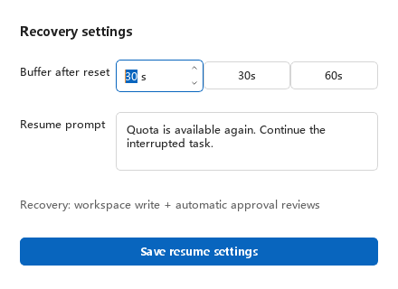
</picture>

Set the continuation prompt and buffer, which defaults to 30 seconds and includes a 60-second shortcut. Writable execution requires a CLI version supporting automatic approval reviews. Unsupported execution fails before closing Codex Desktop; a review rejection can still stop a run.

</details>

### Window planner · prepare a turn before you need it

<picture>
  <source media="(prefers-color-scheme: dark)" srcset="docs/assets/readme/en/planner-dark.png">
  <source media="(prefers-color-scheme: light)" srcset="docs/assets/readme/en/planner-light.png">
  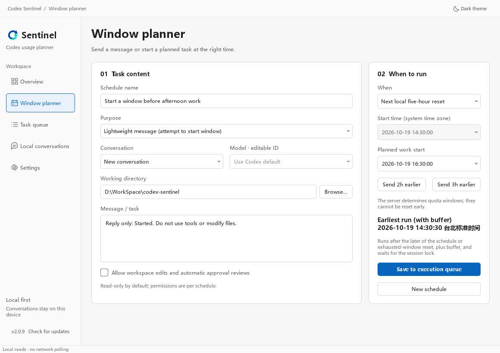
</picture>

Choose an existing or new conversation, directory, cached or manually entered model, and message or task. Schedule a full date and time, use the next locally recorded five-hour reset, or send two to three hours before your planned work start.

The earliest eligible time is `max(scheduled time, known exhausted-window resets) + buffer`. A busy conversation may delay execution further while Sentinel waits for its writer lock. When the model-to-quota mapping is uncertain, scheduling conservatively waits for all known exhausted windows.

### Execution queue · inspect every scheduled run

<picture>
  <source media="(prefers-color-scheme: dark)" srcset="docs/assets/readme/en/queue-dark.png">
  <source media="(prefers-color-scheme: light)" srcset="docs/assets/readme/en/queue-light.png">
  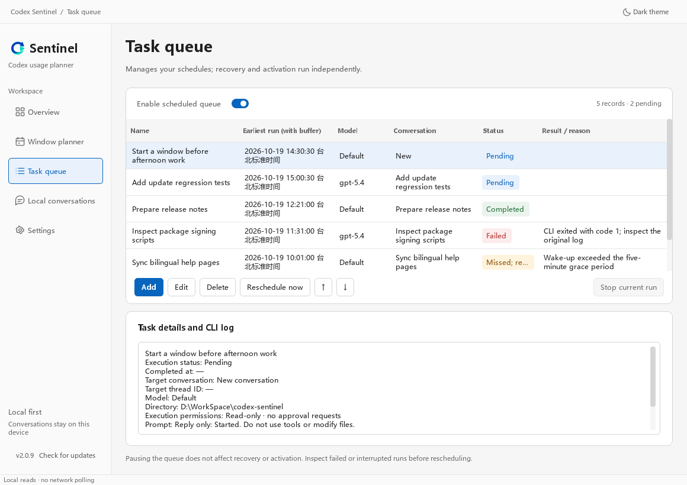
</picture>

Edit, reorder, delete, reschedule, pause dispatch, or stop a running task. The detail panel exposes permissions, target, status, completion time, and raw CLI output. Queue pause lets the current task finish and does not disable recovery or activation.

Completed, failed, interrupted, and cancelled manual tasks are not automatically replayed. Inspect failed logs before rescheduling: a failed run may already have changed files. A completed run can still contain auxiliary service warnings; the execution status is shown separately from raw output.

<details>
<summary>View the separate automation history and execution logs</summary>

<picture>
  <source media="(prefers-color-scheme: dark)" srcset="docs/assets/readme/en/history-dark.png">
  <source media="(prefers-color-scheme: light)" srcset="docs/assets/readme/en/history-light.png">
  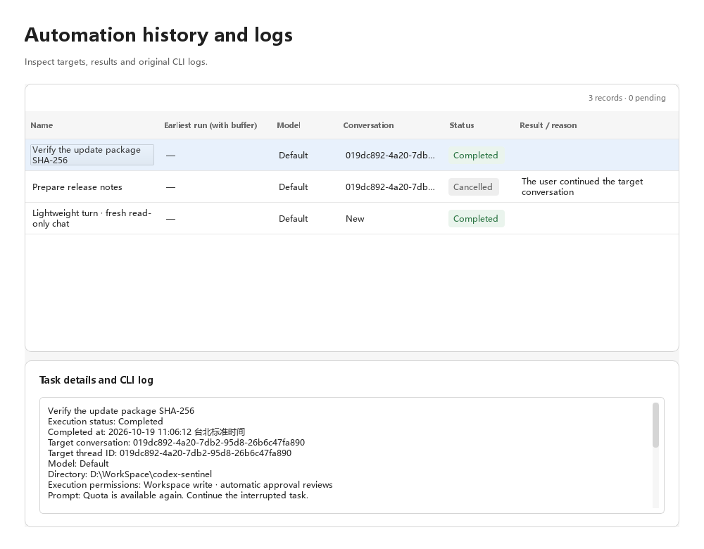
</picture>

Recovery and activation records live in their own read-only history rather than the manual queue. Select a record to inspect its result, conversation, permissions, completion time, and log.

</details>

### Local conversations · find the right context

<picture>
  <source media="(prefers-color-scheme: dark)" srcset="docs/assets/readme/en/sessions-dark.png">
  <source media="(prefers-color-scheme: light)" srcset="docs/assets/readme/en/sessions-light.png">
  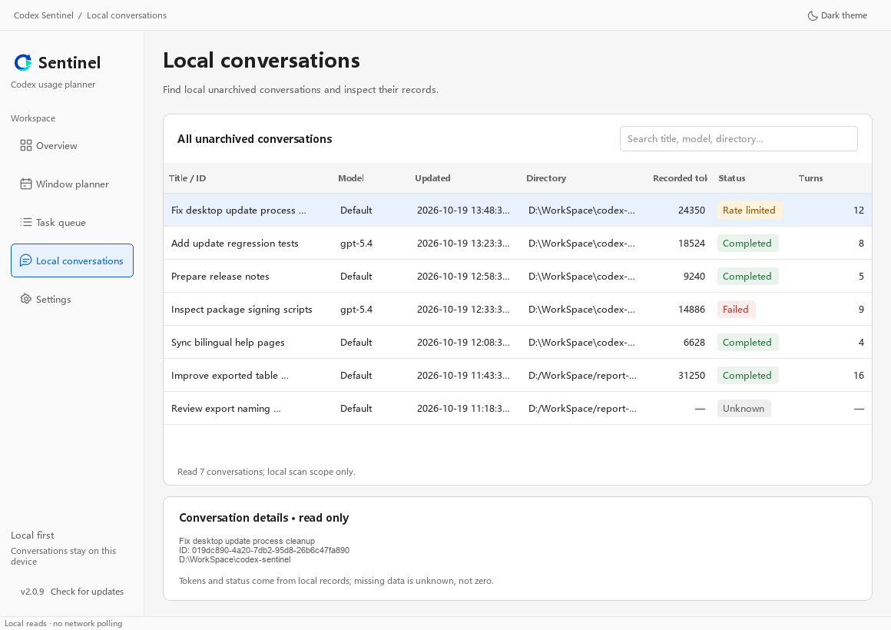
</picture>

Browse the full local index of unarchived interactive chats, grouped by the projects and display titles recorded by Codex. Search titles, models, directories, recorded token totals, and turn states. Select a row to read its full conversation ID and directory. Internal review and subagent logs are excluded from the picker.

### Settings · make the desktop fit your workflow

<picture>
  <source media="(prefers-color-scheme: dark)" srcset="docs/assets/readme/en/settings-dark.png">
  <source media="(prefers-color-scheme: light)" srcset="docs/assets/readme/en/settings-light.png">
  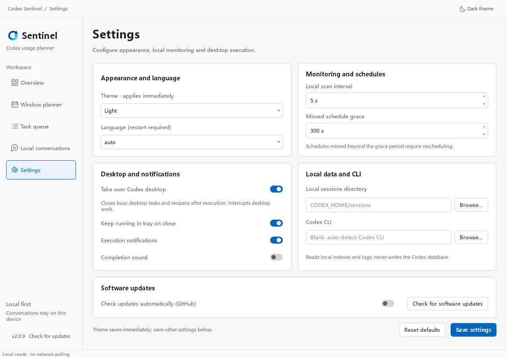
</picture>

Manage CLI discovery, local data paths, execution timing, desktop takeover, update checks, language, and appearance. Use the toolbar for an immediate dark/light switch, or select Dark / Light / System in Settings. Theme changes persist without clearing unsaved forms or log selections; language changes take effect after restart. Existing configurations default to dark.

<details>
<summary>View the update window and system tray</summary>

<picture>
  <source media="(prefers-color-scheme: dark)" srcset="docs/assets/readme/en/updates-dark.png">
  <source media="(prefers-color-scheme: light)" srcset="docs/assets/readme/en/updates-light.png">
  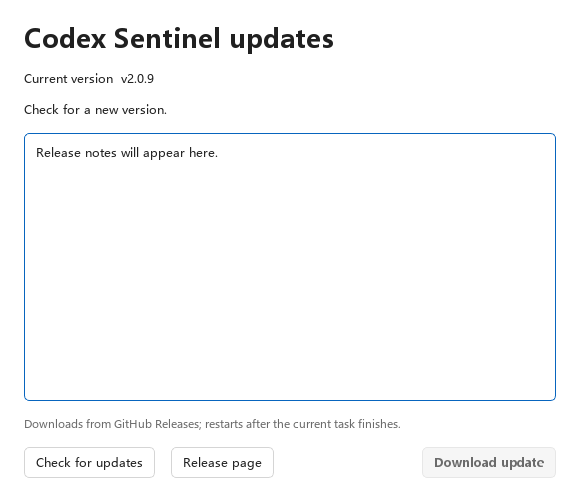
</picture>

Windows x64 folder and single-file builds support in-app updates. A **NEW** badge beside the logo opens release notes and download controls. Checks run on startup and every six hours, with manual checks and an opt-out in Settings.

Downloads support progress and cancellation and are verified with SHA-256. Restart-to-update waits for the current task, holds new dispatches, and starts an independent updater after the app has exited. Replacement or launch-request failure restores old files. User data and unrelated files are preserved. The application directory must be writable, and the update cache must be outside it. Older builds need one manual upgrade; other platforms and source installations use the release page.

<picture>
  <source media="(prefers-color-scheme: dark)" srcset="docs/assets/readme/en/tray-dark.png">
  <source media="(prefers-color-scheme: light)" srcset="docs/assets/readme/en/tray-light.png">
  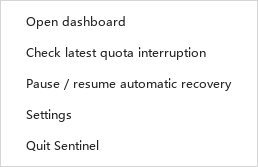
</picture>

Closing the window hides it when a system tray is available. Quit cancels owned child processes and exits cleanly. Only one desktop instance runs per Sentinel data directory.

</details>

## How it works

Sentinel is a Python application with a native **PySide6 / Qt** interface. Local readers build a snapshot for the dashboard and planners; recovery, activation, and the queue share a single CLI executor.

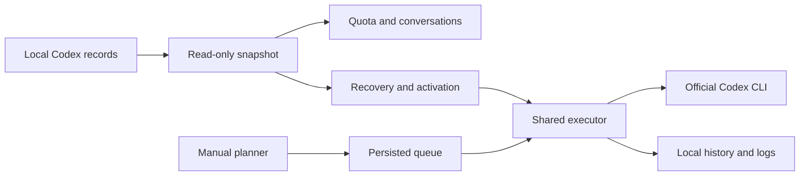

### Desktop takeover and permissions

By default, when a target is busy, Sentinel closes the recognized Codex Desktop process tree, waits for the conversation writer lock, executes the turn, cleans up its own CLI process group, and reopens the desktop. **This can interrupt tasks running in Codex Desktop.** Disable takeover in Settings to wait for the desktop instead.

Windows execution uses a Job Object for child-process cleanup. A cleanup failure pauses recovery, activation, and queue dispatch to avoid overlapping execution. Saved manual tasks retain their permissions and buffers; pending automatic recovery follows the current recovery settings.

### Data and network boundaries

| Data | Location and behavior |
| --- | --- |
| **Codex records** | `CODEX_HOME`, default `~/.codex`: `sessions/**/*.jsonl`, read-only `state_5.sqlite`, `.codex-global-state.json` project metadata, and `models_cache.json`. Sentinel does not write the Codex database or inspect credentials. |
| **Monitoring** | Incremental scans every five seconds by default: latest 100 rollouts, latest 100 visible user chats, and the current recovery target. The picker reads the full unarchived index; older unscanned turn states remain unknown. |
| **Sentinel state** | `CODEX_SENTINEL_HOME`, default `~/.codex-sentinel`: settings, queue, `recovery_state.json`, `activation_state.json`, histories, and execution logs. Corrupt state files are reported rather than silently overwritten. |
| **Execution** | Scheduled turns, recovery, and activation invoke the official CLI, which makes its normal authentication, model, and network requests. Local quota monitoring makes no account or rate-limit polling requests. |
| **Updates** | Optional checks and package downloads access public GitHub Releases. Local conversations, settings, and credentials are not uploaded. Downloaded packages are cached under the Sentinel data directory's `updates/`. |

<details>
<summary>Timing, retries, missed runs, and legacy behavior</summary>

| Situation | Behavior |
| --- | --- |
| **Computer sleeping or app stopped** | Execution requires the computer to be awake and Sentinel running. Manual schedules default to a five-minute grace period, then become missed and require explicit rescheduling. |
| **Recovery after wake** | Re-read the latest interruption, wait for every known exhausted window plus the buffer, and continue monitoring afterward. The manual missed-run grace does not apply to recovery. |
| **Another quota error** | Wait for a newly recorded reset. Missing reset information stays unknown; Sentinel does not infer a new window. Local observations may be stale after account or model changes. |
| **Transient recovery network errors** | Retry at most twice, after 30 and 60 seconds. Successful, cancelled, approval-failed, and crash-interrupted recovery is not replayed for the same interruption. |
| **Execution timeouts** | Lightweight messages time out after 120 seconds; tasks after one hour. |
| **Activation preflight** | The MCP configuration query has a 30-second timeout and one retry on timeout. Repeated timeouts stop before sending; a query retry does not resend the activation turn. |
| **Older recovery queue entries** | Migrated into the separate automation history; only the latest eligible interruption is monitored. |
| **Legacy daemon** | Retains its prior takeover/relaunch behavior. Use desktop mode for the scheduler, durable execution records, and writer-lock waiting. |

</details>

## Development

Create a virtual environment using the source setup above, then install the development extras:

```sh
python -m pip install -e ".[dev]"
python -m pytest -q
python scripts/render_gui.py
python scripts/render_readme.py
```

Use your virtual environment's Python for these commands. Tests use isolated fixtures and fake executors; they do not make real model requests. The renderers capture the actual UI with synthetic data. `render_readme.py` produces both languages, both themes, all five pages, and the supporting dialogs. See [screenshot documentation](docs/assets/readme/README.md).

### Windows packaging

```powershell
.\.venv\Scripts\python.exe -m pip install pyinstaller
.\.venv\Scripts\python.exe scripts/build_windows.py
```

Outputs are `dist/desktop/CodexSentinel/`, `dist/CodexSentinel-windows-x64.zip`, and `dist/codex-sentinel-windows-x64.exe`. Both Windows formats include the independent updater.

The [release workflow](.github/workflows/release.yml) builds Windows, Linux, macOS, Python wheels, and source distributions, then publishes release assets and checksums. A `v<version>` tag must match the versions in `pyproject.toml` and `codex_sentinel/__init__.py`. Release asset names include the tag; Python distributions use their standard versioned names.

### Contributing

Bug reports and focused pull requests are welcome. [Open an issue](https://github.com/iss-hui/codex-sentinel/issues) with the Sentinel version, operating system, CLI version, reproduction steps, and relevant redacted logs. Include screenshots for interface issues. For execution changes, cover permissions, duplicate prevention, scheduling, and process cleanup with isolated tests; for UI changes, check both languages, both themes, and narrower windows.

## Project references

- [Changelog](CHANGELOG.md) — release-by-release changes.
- [Desktop design and theme implementation](docs/neutral-desktop-ui.md) — the five-page UI, appearance behavior, and validation.
- [Desktop handoff](docs/desktop-handoff.md) — implementation and execution details.
- [Earlier desktop implementation notes](docs/desktop-completion.md) — historical context.
- [Screenshot reproduction](docs/assets/readme/README.md) — image inventory and fixture-based rendering.

## License

[MIT](LICENSE).
