<div align="center">
  
  <h1>Codex Sentinel</h1>
  <p><strong>为 Codex 打造的桌面限额看板、任务预约与对话恢复工具。</strong></p>
  <p>看清下个窗口，安排下一次执行，接续被中断的工作。</p>
  <p>
    <a href="https://github.com/iss-hui/codex-sentinel/releases/latest"></a>
    <a href="https://github.com/iss-hui/codex-sentinel/actions/workflows/release.yml"></a>
    <a href="pyproject.toml"></a>
    <a href="LICENSE"></a>
  </p>
  <p><a href="README.md">English</a> · <strong>简体中文</strong></p>
  <p><a href="https://github.com/iss-hui/codex-sentinel/releases/latest">下载新版</a> · <a href="#快速开始">快速开始</a> · <a href="#界面与功能">界面与功能</a> · <a href="#运行机制">运行机制</a> · <a href="#开发与构建">开发与构建</a></p>
</div>

<picture>
  <source media="(prefers-color-scheme: dark)" srcset="docs/assets/readme/zh/overview-dark.png">
  <source media="(prefers-color-scheme: light)" srcset="docs/assets/readme/zh/overview-light.png">
  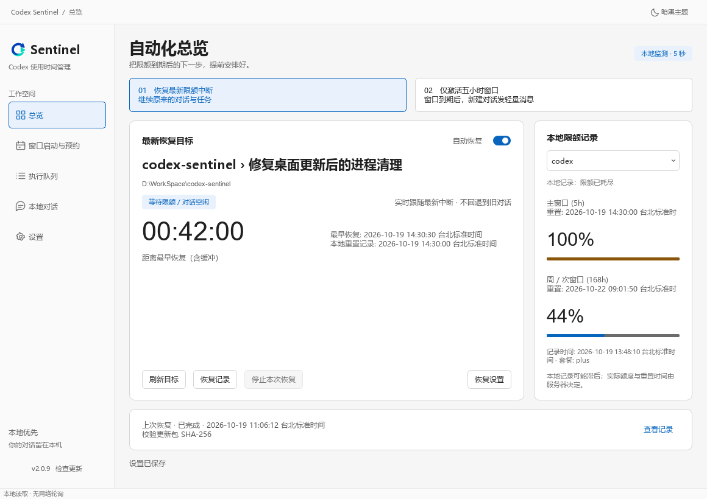
</picture>

*以上及下文均为实际 PySide6 桌面界面，使用模拟本地数据截图。配图提供明暗两套版本，随 GitHub 主题展示。[截图来源与生成方式](docs/assets/readme/README.md)。*

Codex Sentinel 将本地限额记录、对话恢复和定时 CLI 执行集中到一个原生桌面应用中。它面向使用 Codex 持续处理开发任务的用户，帮助你掌握窗口状态、提前安排下一次工作，并在执行后查看结果与日志。

应用提供五个主页面、系统托盘、中英文界面，以及可持久保存的暗黑、白色和跟随系统主题。实际执行通过你已安装并登录的官方 Codex CLI 完成。

> 限额与重置由服务端决定。Sentinel 根据本地记录安排重置后的执行，无法重置配额、绕过限制，也不能保证发送一条消息就会开启新的五小时窗口。

## 核心能力

| 能力 | 解决的问题 |
| --- | --- |
| **本地限额总览** | 集中查看五小时与周窗口用量、重置时间、记录新鲜度和限额分组，明确标记未知或过期数据。 |
| **自动恢复对话** | 主动开启后，在已知限额恢复并经过缓冲时，继续最新的限额中断聊天；记录和日志独立保存。 |
| **持续激活窗口** | 按每个新记录的窗口，在全新只读对话中发送轻量消息；可指定目录、模型和首次激活时间。 |
| **窗口预约** | 按完整日期时间、下次记录的重置时间，或计划开始工作前的提前量，预约消息与任务。 |
| **执行队列** | 保存、编辑、排序、改期、暂停和停止任务，逐项设置权限并检查 CLI 原始日志。 |
| **原生桌面体验** | 搜索本地对话、即时切换明暗主题、通过托盘保持运行，并在受支持的 Windows 打包版中更新软件。 |

## 快速开始

### 下载发行版

前往 **[GitHub Releases 获取最新版本](https://github.com/iss-hui/codex-sentinel/releases/latest)**。每次发布均提供 `SHA256SUMS.txt`，用于校验下载文件。

| 平台 | 下载文件 | 启动方式 |
| --- | --- | --- |
| **Windows x64 · 目录版** | `CodexSentinel-windows-x64-v<version>.zip` | 完整解压，打开 `CodexSentinel.exe`，保留旁边的 `_internal` 目录。 |
| **Windows x64 · 单文件版** | `codex-sentinel-windows-x64-v<version>.exe` | 运行下载的可执行文件。 |
| **Linux x64** | `codex-sentinel-linux-x64-v<version>` | 添加可执行权限后，在图形桌面会话中运行。 |
| **macOS** | `codex-sentinel-macos-v<version>` | 使用发布页提供的二进制文件，或从源码运行。 |
| **Python** | 带版本号的 `.whl` 与 `.tar.gz` | 安装 Python 包，或参考下方源码启动步骤。 |

请先安装并登录官方 Codex CLI。Sentinel 会自动查找，也可以在**设置**中指定可执行文件路径。打包版无需单独安装 Python；源码运行需要 Python 3.10 或更高版本。

### 第一次使用

1. 打开**设置**，确认 CLI 与本地数据目录，选择语言和主题。
2. 在**总览**查看本地限额及重置记录；显示“未知”表示尚未读到可用记录。
3. 需要继续被限额中断的聊天时，开启**自动恢复**；需要在新对话发送轻量消息时，选择**持续激活**。两者默认关闭，且互斥运行。
4. 用**窗口预约**安排手动任务，在**执行队列**检查进度与日志。启用执行前请确认桌面接管设置：默认开启，可能中断 Codex Desktop 中正在运行的任务。

### 从源码启动

Windows PowerShell：

```powershell
git clone https://github.com/iss-hui/codex-sentinel.git
cd codex-sentinel
python -m venv .venv
.\.venv\Scripts\python.exe -m pip install -e .
.\.venv\Scripts\python.exe run_desktop.py
```

<details>
<summary>Linux / macOS 源码启动</summary>

```sh
git clone https://github.com/iss-hui/codex-sentinel.git
cd codex-sentinel
python3 -m venv .venv
.venv/bin/python -m pip install -e .
.venv/bin/python run_desktop.py
```

</details>

安装后也可使用以下入口：

```sh
codex-sentinel                     # 默认桌面界面
codex-sentinel-gui                 # 无控制台桌面入口
codex-sentinel --gui --lang zh     # 中文界面
codex-sentinel --gui --dry-run     # 模拟执行，不发送消息
codex-sentinel --daemon            # 原有命令行守护模式
codex-sentinel --status            # 原有单次限额检查
```

`--buffer 30`、`--buffer 60` 和 `--prompt` 可覆盖对应桌面设置。GUI 启动失败会报错退出，不会自动切换到会发送消息的守护模式。`--no-relaunch` 仅用于原有守护模式；桌面模式的接管和重新打开行为在设置中调整。

## 界面与功能

### 总览 · 让下一步操作清晰可见

首页将恢复或激活工作区与限额记录并排展示，集中呈现目标聊天、完整工作目录、最早执行时间和含缓冲的倒计时。窄窗口会将面板上下排列，表格保留完整列并在内部滚动。

| 执行方式 | 目标与触发条件 | 权限策略 |
| --- | --- | --- |
| **自动恢复** | 按实际中断时间选择最新的可恢复聊天，等待所有已知耗尽窗口及缓冲结束。 | 工作区可读写，启用 Codex 自动审批审核（`codex exec --approve-for-me`）。 |
| **持续激活** | 在每个新记录的五小时重置后新建聊天，可指定首次激活日期时间；周限额同样生效。 | 只读轻量消息，仅在本次调用中禁用 MCP、连接器和插件。 |
| **手动预约** | 按预约时间，在新对话或已有对话中发送消息、执行任务。 | 默认只读，每项任务可单独选择权限。 |

自动恢复与持续激活独立于手动队列开关，但三种流程共用一个执行器；当前任务结束后，已到期的自动恢复优先。恢复开关立即保存，关闭时也会停止当前恢复；恢复语句与缓冲修改需要明确保存。

<details>
<summary>展开查看持续激活与恢复设置</summary>

<picture>
  <source media="(prefers-color-scheme: dark)" srcset="docs/assets/readme/zh/activation-dark.png">
  <source media="(prefers-color-scheme: light)" srcset="docs/assets/readme/zh/activation-light.png">
  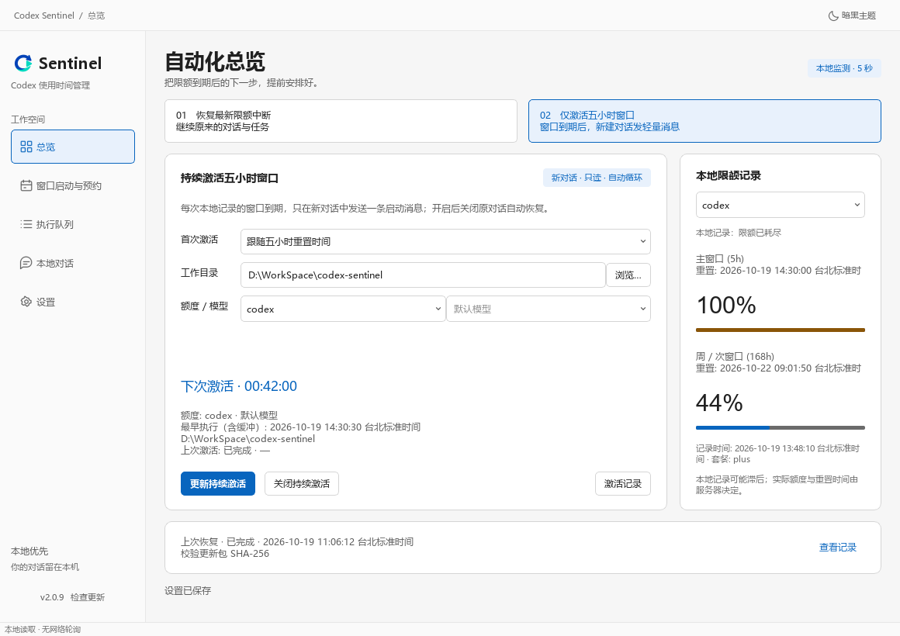
</picture>

选择限额组、工作目录和模型。每个已记录窗口仅尝试一次，持久状态避免重启、失败或取消后重复发送。执行后等待新的本地重置记录，不会自行推测五小时后的下一次重置。激活所需的临时配置不会改动全局 Codex 配置。

<picture>
  <source media="(prefers-color-scheme: dark)" srcset="docs/assets/readme/zh/recovery-settings-dark.png">
  <source media="(prefers-color-scheme: light)" srcset="docs/assets/readme/zh/recovery-settings-light.png">
  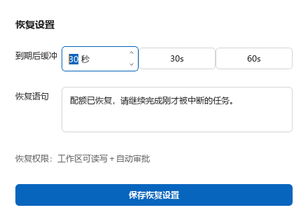
</picture>

恢复缓冲默认为 30 秒，提供 60 秒快捷选项，也支持自定义。可写执行需要支持自动审批审核的 Codex CLI；不支持时会在关闭桌面之前报错。审批拒绝仍可能中止执行，日志会记录本次请求的权限策略。

</details>

### 窗口预约 · 在需要之前安排好执行

<picture>
  <source media="(prefers-color-scheme: dark)" srcset="docs/assets/readme/zh/planner-dark.png">
  <source media="(prefers-color-scheme: light)" srcset="docs/assets/readme/zh/planner-light.png">
  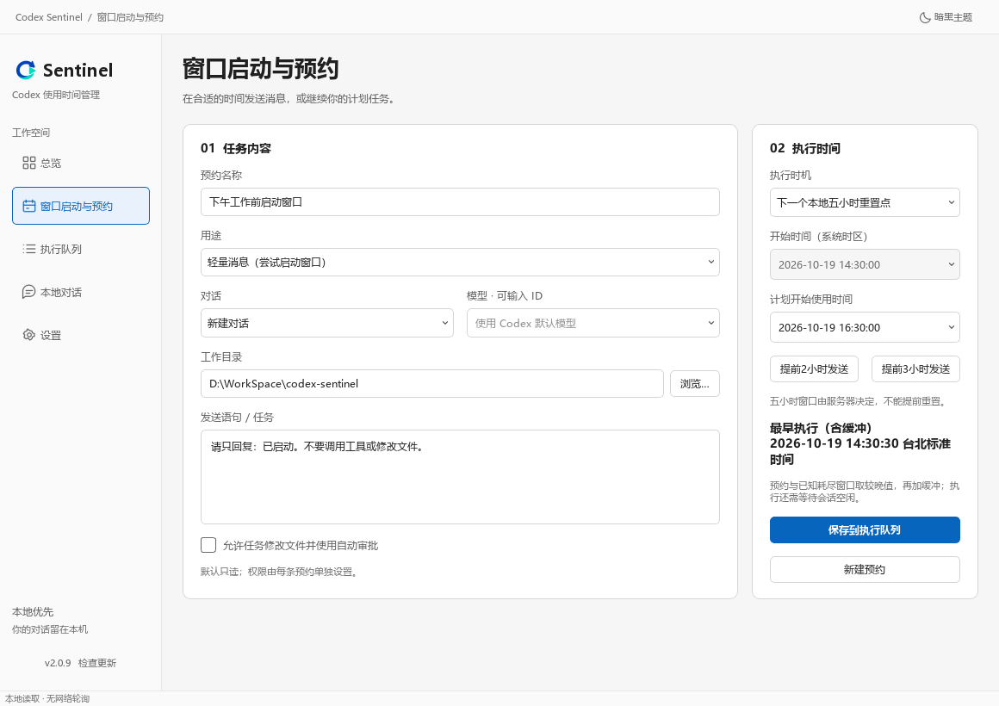
</picture>

选择已有或新建对话、工作目录、缓存或手动输入的模型，并填写消息或任务。支持完整日期时间、下次本地记录的五小时重置，以及计划开始工作前两至三小时的提前发送。

最早可执行时间为 `max(预约时间, 已知耗尽窗口的重置时间) + 缓冲`。如果目标对话被占用，还会继续等待写锁。无法可靠判断模型对应限额组时，会保守等待所有已知耗尽窗口。

### 执行队列 · 每次执行都有据可查

<picture>
  <source media="(prefers-color-scheme: dark)" srcset="docs/assets/readme/zh/queue-dark.png">
  <source media="(prefers-color-scheme: light)" srcset="docs/assets/readme/zh/queue-light.png">
  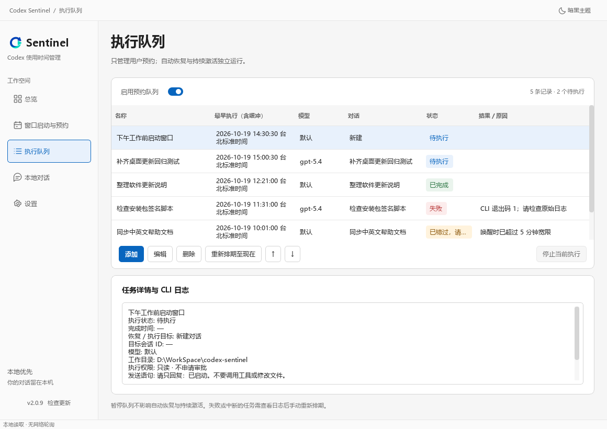
</picture>

支持编辑、排序、删除、改期、暂停派发和停止运行中的任务。详情区展示目标、权限、状态、完成时间与 CLI 原始输出。暂停队列会保留当前任务继续执行，不会关闭自动恢复或持续激活。

已完成、失败、中断或取消的手动任务不会自动重放。失败也可能已经产生部分文件修改，请先查看日志再决定是否重试。已完成执行可能仍包含辅助服务的错误或警告，因此界面会将执行状态和原始日志分开展示。

<details>
<summary>展开查看独立的自动化记录与执行日志</summary>

<picture>
  <source media="(prefers-color-scheme: dark)" srcset="docs/assets/readme/zh/history-dark.png">
  <source media="(prefers-color-scheme: light)" srcset="docs/assets/readme/zh/history-light.png">
  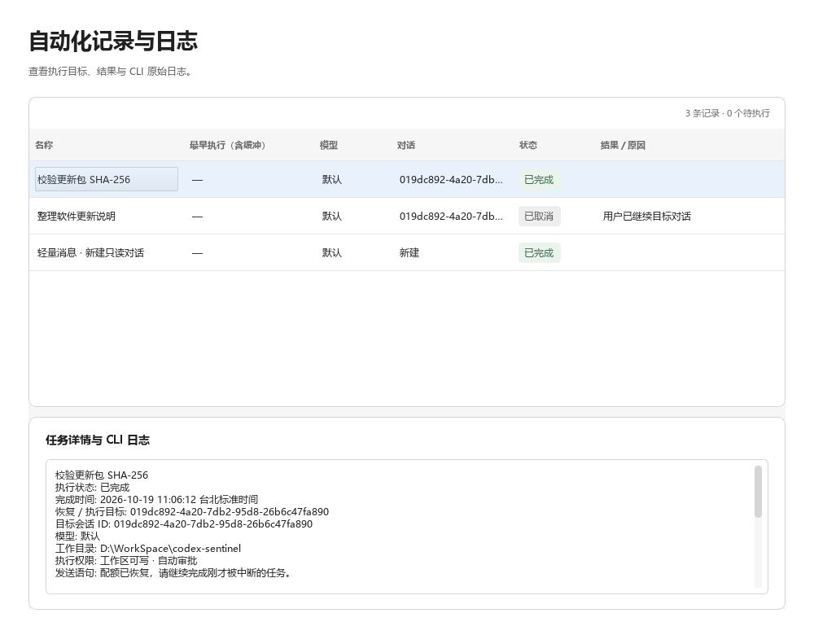
</picture>

自动恢复和持续激活进入独立的只读历史，不混入手动执行队列。选中记录可查看结果、会话、权限、完成时间与日志。

</details>

### 本地对话 · 快速找回工作上下文

<picture>
  <source media="(prefers-color-scheme: dark)" srcset="docs/assets/readme/zh/sessions-dark.png">
  <source media="(prefers-color-scheme: light)" srcset="docs/assets/readme/zh/sessions-light.png">
  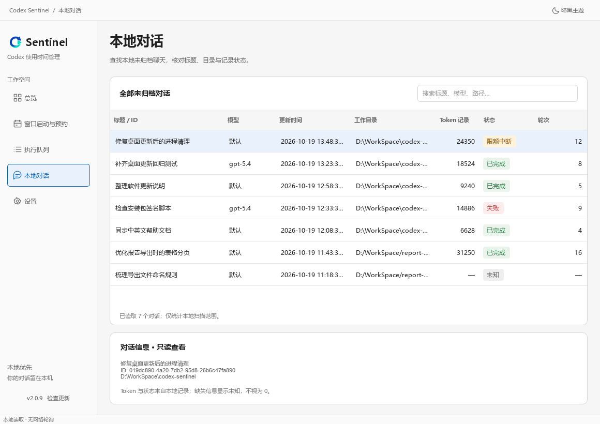
</picture>

读取完整的本地未归档交互聊天索引，使用 Codex 保存的项目分组与聊天标题。可搜索标题、模型、目录、已记录 Token 总量及轮次状态，选中后查看完整会话 ID 和目录。内部审查与子代理日志不会出现在对话选择器中。

### 设置 · 适配你的桌面工作方式

<picture>
  <source media="(prefers-color-scheme: dark)" srcset="docs/assets/readme/zh/settings-dark.png">
  <source media="(prefers-color-scheme: light)" srcset="docs/assets/readme/zh/settings-light.png">
  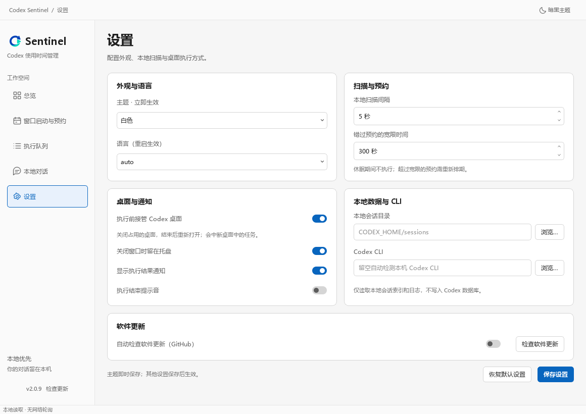
</picture>

集中配置 CLI、本地数据路径、执行时间、桌面接管、更新检查、语言和外观。右上角可即时切换暗黑与白色主题；设置中还可选择跟随系统。主题自动保存，不会清空未提交的表单或已选中的日志文字；语言修改在重启后生效。旧配置默认使用暗黑主题。

<details>
<summary>展开查看软件更新与系统托盘</summary>

<picture>
  <source media="(prefers-color-scheme: dark)" srcset="docs/assets/readme/zh/updates-dark.png">
  <source media="(prefers-color-scheme: light)" srcset="docs/assets/readme/zh/updates-light.png">
  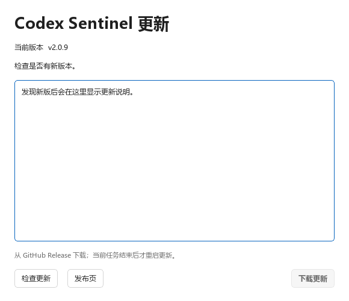
</picture>

Windows x64 目录版和单文件版均支持应用内更新。发现新版后，左上角图标旁出现 **NEW**，点击查看说明和下载。启动时及运行期间每六小时检查一次，也可在设置中手动检查或关闭自动检查。

下载支持进度、取消与 SHA-256 校验。“重启更新”会等当前任务结束并暂停新任务派发，主程序退出后由独立更新器替换文件并重新启动。替换或启动请求失败时恢复旧文件，保留用户数据与应用目录内的无关文件。应用目录需要当前用户可写，更新缓存应位于应用目录之外。旧版本需先手动升级一次；其他平台和源码运行通过发布页更新。

<picture>
  <source media="(prefers-color-scheme: dark)" srcset="docs/assets/readme/zh/tray-dark.png">
  <source media="(prefers-color-scheme: light)" srcset="docs/assets/readme/zh/tray-light.png">
  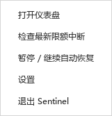
</picture>

系统托盘可用时，关闭窗口会隐藏到托盘。选择退出会取消本应用拥有的子进程并正常结束。同一 Sentinel 数据目录只允许一个桌面实例运行。

</details>

## 运行机制

Sentinel 使用 **Python + PySide6 / Qt** 构建原生界面。本地读取器生成限额与对话快照，自动恢复、持续激活和手动队列共用一个 CLI 执行器。

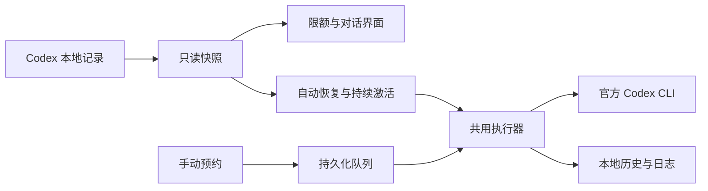

### 桌面接管与执行权限

默认情况下，目标被占用时会关闭识别到的 Codex Desktop 进程树，等待会话写锁释放，再运行任务、清理自身 CLI 进程组并重新打开桌面。**这会中断 Codex Desktop 中正在执行的工作。** 关闭设置中的接管选项后，会等待桌面释放占用。

Windows 使用 Job Object 清理子进程；清理失败会暂停恢复、激活和队列派发，避免重叠执行。已保存的手动任务保留各自权限与缓冲，待执行的自动恢复遵循当前恢复设置。

### 数据与网络边界

| 数据 | 位置与行为 |
| --- | --- |
| **Codex 本地记录** | `CODEX_HOME`，默认 `~/.codex`：`sessions/**/*.jsonl`、只读 `state_5.sqlite`、项目元数据 `.codex-global-state.json` 和 `models_cache.json`。不写入 Codex 数据库，不读取凭据。 |
| **监控扫描** | 默认每五秒增量扫描最新 100 个 rollout、最新 100 个可见用户聊天及当前恢复目标。对话选择器读取完整未归档索引；较旧且未扫描的轮次状态保持未知。 |
| **Sentinel 自身状态** | `CODEX_SENTINEL_HOME`，默认 `~/.codex-sentinel`：设置、队列、`recovery_state.json`、`activation_state.json`、历史和日志。损坏文件会报错，不会静默覆盖。 |
| **实际执行** | 预约、恢复和激活通过官方 CLI 完成，CLI 可能发起正常的认证、模型及网络请求。本地限额监控不轮询账号或服务端限额接口。 |
| **软件更新** | 可选检查及下载访问公开 GitHub Releases，不上传本地对话、设置或凭据。下载缓存在 Sentinel 数据目录的 `updates/` 下。 |

<details>
<summary>展开查看时间、重试、错过任务及旧模式行为</summary>

| 情况 | 处理方式 |
| --- | --- |
| **电脑休眠或应用未运行** | 执行需要电脑保持唤醒且 Sentinel 正在运行。手动预约默认有五分钟宽限，超过后标记错过，需要手动改期。 |
| **唤醒后的自动恢复** | 重新读取最新中断，等待所有已知耗尽窗口与缓冲，执行后继续监控；不沿用手动任务的错过宽限。 |
| **再次遇到限额** | 等待新的本地重置记录。缺少时间时保持未知，不推测新窗口。账号或模型切换后，本地记录可能过期。 |
| **恢复时的临时网络错误** | 最多重试两次，分别等待 30 秒和 60 秒。同一次中断在成功、取消、审批失败或崩溃中断后不会重放。 |
| **执行超时** | 轻量消息 120 秒，任务一小时。 |
| **激活前置检查** | MCP 配置查询每次允许 30 秒，超时后重试一次；仍超时则在发送前失败。查询重试不会重复发送激活消息。 |
| **旧版恢复队列条目** | 迁移到独立自动化历史，仅监控最新的可恢复中断。 |
| **原有守护模式** | 保留此前的桌面接管与重开行为。新调度、持久执行记录及写锁等待请使用桌面模式。 |

</details>

## 开发与构建

按源码启动步骤创建虚拟环境后，安装开发依赖并运行检查：

```sh
python -m pip install -e ".[dev]"
python -m pytest -q
python scripts/render_gui.py
python scripts/render_readme.py
```

请使用虚拟环境中的 Python 执行上述命令。测试使用隔离数据与模拟执行器，不会发起真实模型请求。截图脚本使用实际界面和模拟数据，`render_readme.py` 覆盖中英文、明暗主题、五个主页面及相关窗口，详见[截图说明](docs/assets/readme/README.md)。

### Windows 打包

```powershell
.\.venv\Scripts\python.exe -m pip install pyinstaller
.\.venv\Scripts\python.exe scripts/build_windows.py
```

生成 `dist/desktop/CodexSentinel/`、`dist/CodexSentinel-windows-x64.zip` 和 `dist/codex-sentinel-windows-x64.exe`，两种 Windows 分发格式均包含独立更新器。

[发布流水线](.github/workflows/release.yml) 构建 Windows、Linux、macOS、Python wheel 和源码包，随后发布附件及校验和。`v<version>` 标签必须与 `pyproject.toml`、`codex_sentinel/__init__.py` 的版本一致；发布附件带版本标签，Python 包遵循标准命名。

### 参与贡献

欢迎提交问题与范围明确的 Pull Request。[反馈问题](https://github.com/iss-hui/codex-sentinel/issues)时，请提供 Sentinel 版本、操作系统、CLI 版本、复现步骤和已脱敏日志；界面问题请附截图。涉及执行行为时，请用隔离测试覆盖权限、去重、调度和进程清理；涉及界面时，请检查中英文、明暗主题及较窄窗口。

## 项目文档

- [更新日志](CHANGELOG.md)：逐版本变更记录。
- [桌面设计与主题实现](docs/neutral-desktop-ui.md)：五个页面、主题行为与验证记录。
- [桌面交接说明](docs/desktop-handoff.md)：实现与执行细节。
- [早期桌面实现记录](docs/desktop-completion.md)：历史背景。
- [截图生成说明](docs/assets/readme/README.md)：配图清单与模拟数据渲染方式。

## 许可证

[MIT](LICENSE)。
